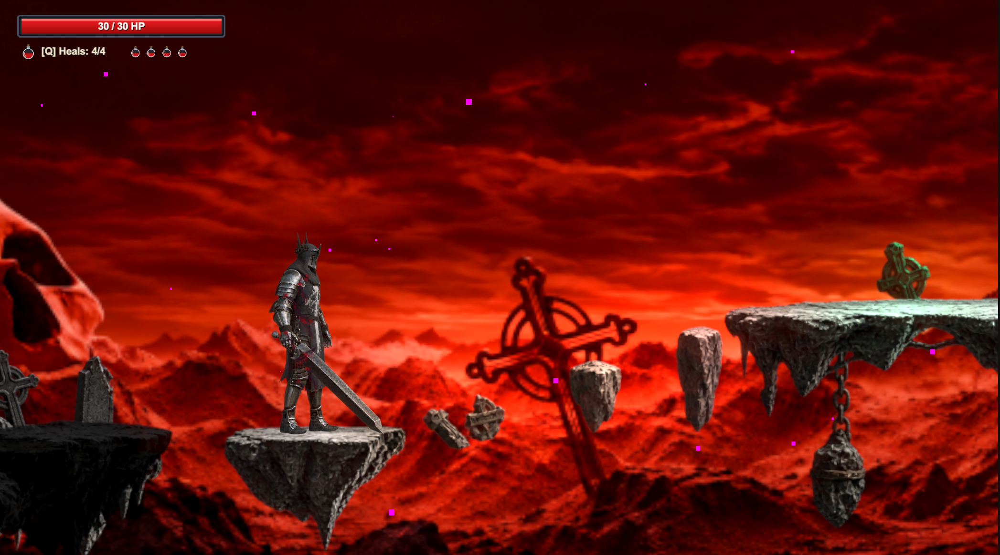

<div align="center">

# GAMJAM

### Rise, fallen knight. The abyss is not your ending.

A dark fantasy 2D action platformer built with Unity.
Fight through a ruined underworld, confront Malakor, and open the gateway beyond.

**Unity 6000.6.7f1 · C# · Universal Render Pipeline · Keyboard & Mouse**

[Getting started](#getting-started) · [Controls](#controls) · [Combat](#combat--survival) · [Project structure](#project-structure)

</div>



*Gameplay screenshot — traverse the shattered platforms of the underworld.*

## Enter the underworld

Death has cast you into the abyss. Your oath remains unbroken.

Take control of a fallen knight in a hostile landscape of crimson skies, ruined stone, and armored enemies. Cross dangerous terrain, choose your openings, and conserve your healing before facing **Malakor, the Abyssal Warlord**. Defeating the boss unlocks the final gateway; stepping through completes the level.

## What awaits

| Feature | In the game |
| :--- | :--- |
| **Deliberate sword combat** | Two-hit light combos and a charged heavy attack reward timing and commitment. |
| **Active defense** | Dodge, roll, or time a parry to answer an incoming attack. |
| **A hostile journey** | Armored guards, spikes, chasms, and checkpoints shape the route to the boss. |
| **A climactic encounter** | Malakor uses melee attacks, slams, shockwaves, and additional attack patterns. |
| **A cinematic opening** | Narrated introduction with Gothic captions, ambience, and a sword sound timed to the blade lift. |
| **Combat feedback** | Sword effects, blood effects, camera shake, and heavy-hit pauses give attacks a sense of weight. |

## Controls

Click inside Unity's **Game** view before playing in the editor.

| Input | Action |
| :--- | :--- |
| **A / D** or **Left / Right arrows** | Move |
| **Space** | Jump; release early for a shorter jump |
| **Left mouse button** | Light attack; press again during the combo window for the second strike |
| **Hold right mouse button** | Charge a heavy attack; release to strike |
| **Left Shift** | Dodge |
| **Left Ctrl** | Roll while grounded |
| **E** | Parry while grounded |
| **Q** | Use a healing flask |
| **Escape** | Skip the opening cutscene; pause or resume during gameplay |
| **R** | Respawn after death, or restart from the pause menu |

## Combat & survival

The knight currently starts with **30 HP** and **four healing flasks**, each restoring **10 HP** up to the health limit. Healing requires missing health and an available flask.

Basic boss damage values range from **3 to 6 HP** depending on the attack. Treat the larger attacks as threats worth avoiding: recovery windows, attack combinations, and positioning still matter. These values are a starting balance and may change with playtesting.

**A few things to learn early:**

- Use light attacks when the opening is short, and charge a heavy strike when you have time to commit.
- Rolls and parries require you to be on the ground.
- Attacks and defensive actions have timing windows and cooldowns.
- Save healing for a safe opening and use checkpoints as you progress.

## Getting started

### Requirements

- **Unity Hub** and **Unity Editor 6000.6.7f1**, matching `ProjectSettings/ProjectVersion.txt`.
- **Git** and **Git LFS**. This repository tracks MP4 and ZIP files with LFS.
- Internet access for Unity's initial package restore. The manifest includes a Git-based Unity MCP package, so Git should be available on your system path.

### Clone and open

```bash
git lfs install
git clone https://github.com/garrerohit-create/gamejam.git
cd gamejam
git lfs pull
```

1. In Unity Hub, add the cloned **gamejam** directory as an existing project.
2. Open it with **6000.6.7f1** and let Unity finish importing assets and resolving packages.
3. Open `Assets/Scenes/SampleScene.unity`.
4. Press **Play**. The opening cutscene runs before gameplay; press **Escape** to skip it.

If the opening video is missing or appears as a small text file, run `git lfs pull` from the repository folder and let Unity refresh.

### Build locally

Open Unity's **Build Profiles**, select the desktop platform you want to target, and ensure `Assets/Scenes/SampleScene.unity` is included and enabled in the scene list. Install the matching platform module through Unity Hub if needed, then build to a separate output directory.

The opening video is stored in `Assets/StreamingAssets/OpeningCutscene.mp4`, which Unity includes with the build. Keep the complete generated build together when sharing it.

## Project structure

```text
Assets/
├── Audio/                 Combat, movement, boss, and environment sounds
├── Art/                   Visual assets and effects
├── Prefabs/               Reusable objects and enemies
├── Scenes/                Main gameplay scene
├── Screenshots/           Development screenshots
├── Scripts/
│   ├── Audio/             Sound mapping and playback
│   ├── Enemies/           Armored guard and boss behavior
│   └── Environment/       Gates and arena behavior
└── StreamingAssets/       Opening cutscene video
Packages/                  Unity package dependencies
ProjectSettings/           Editor, rendering, input, and build settings
Tools/                     Asset preparation utilities
```

### Useful entry points

- [KnightMovement.cs](Assets/Scripts/KnightMovement.cs) — movement, attacks, dodge, roll, and parry.
- [PlayerHealth.cs](Assets/Scripts/PlayerHealth.cs) — health, damage, and healing flasks.
- [BossAI.cs](Assets/Scripts/Enemies/Boss/BossAI.cs) — Malakor's behavior and attacks.
- [AudioManager.cs](Assets/Scripts/Audio/AudioManager.cs) — sound IDs, asset mappings, and playback.
- [OpeningCutscene.cs](Assets/Scripts/OpeningCutscene.cs) — opening playback and transition to gameplay.
- [GameManager.cs](Assets/Scripts/GameManager.cs) — pause, death, and respawn flow.

## Audio & credits

Some game effects use **Kenney** audio. Source notes and included license files are in [Assets/Audio/Licenses](Assets/Audio/Licenses).

The current light and heavy sword sounds, along with the cutscene's sword-unsheathing effect, use supplied **Dragon Studio** recordings. The opening narration uses original text with a synthetic British voice.

Third-party assets retain their respective terms; the included Kenney licenses apply to those audio sources, not to the entire project.

---

<div align="center">

**Survive the journey. Face Malakor. Pass beyond the gates.**

</div>
